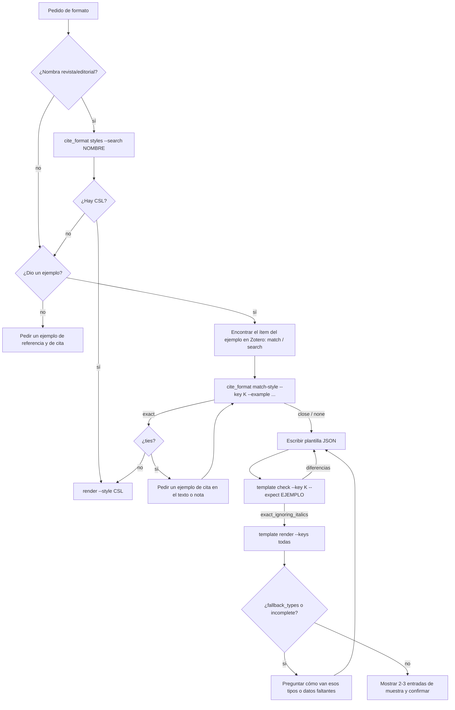

# Formatos a medida: adaptarse al ejemplo del usuario

Cuando el usuario no pide "APA" o "Chicago" sino **un formato** —el de una revista, el de su cátedra o el de un ejemplo que pega—, el ejemplo manda. El objetivo es reproducirlo exactamente en todas las referencias, sin completar por suposición lo que el ejemplo no muestra.

## Flujo



1. **¿Hay un estilo oficial?** Si el usuario nombra una revista, una editorial o una institución, buscalo: `cite_format.py styles --search "Revista X"` (10 800+ estilos del repositorio de Zotero). Un CSL oficial maneja casos que una plantilla no ve: decenas de tipos, sin autor, sin fecha, traducciones.
2. **Ubicá el ítem del ejemplo** en la biblioteca (`zotero_client.py search --title ... --author ...`). Si no está, pedí otro ejemplo de una obra que sí esté, o crealo primero (validación + `create`).
3. **`match-style --key K --example "..."`** compara el ejemplo con unos 13 estilos comunes (APA 7/6, Chicago 18/17, MLA, Harvard, ISO 690 en español, ASA, APSA, IEEE) más los que agregues (`--styles`, `--search`).
   - `exact` sin `ties` → usá ese CSL para todo.
   - `ties` → varios estilos dan la misma referencia (p. ej. Chicago notas y MLA para un libro). Pedí un ejemplo de **cita en el texto o nota** y volvé a correrlo con ese ejemplo.
   - `close` → mostrá `differences`. Si el usuario confirma que esas diferencias son intencionales, pasá a la plantilla.
   - `none` → plantilla.
4. **Plantilla**: escribila con lo que el ejemplo muestra y verificá con `template check` hasta `exact` o `exact_ignoring_italics` (un ejemplo pegado en el chat no muestra cursivas: preguntá si las lleva y dónde).
5. **`template render`** sobre todas las claves. Si aparecen `fallback_types` (tipos de obra que el ejemplo no cubre: capítulo, tesis, página web…) o `incomplete` (datos obligatorios vacíos), **preguntá** cómo los quiere antes de entregar. Nunca inventes el patrón de un tipo que el usuario no mostró.
6. Mostrá 2 o 3 entradas de muestra de tipos distintos y confirmá antes de reescribir todo el manuscrito.
7. Para auditar el manuscrito en un formato a medida: `cite_audit.py audit --style <base> --no-lint`. Elegí como base el sistema del ejemplo (`apa` o `chicago-author-date` si cita autor-año en el texto, `chicago-notes` si usa notas): eso cruza citas y referencias sin aplicar reglas ajenas al formato.

## Qué preguntar (solo lo que el ejemplo no resuelve)

- Cursivas: dónde van (título, revista, volumen).
- Tipos no mostrados: "Su ejemplo es un artículo. ¿Cómo quiere los capítulos de libro?" Ofrecé una propuesta concreta derivada del ejemplo, para que el usuario solo confirme o corrija.
- Muchos autores: desde cuántos se corta y cómo ("et al.", "y otros").
- Sin fecha / sin autor.
- Cita en el texto: si no la mostró, pedila; no la deduzcas de la referencia.
- Página en la cita: separador (", p. 61", ": 61", ", 61").

Una pregunta por vez, con una propuesta concreta. Registrá las respuestas en la plantilla (es reutilizable para el próximo trabajo del mismo usuario).

## Lenguaje de plantillas

Archivo JSON:

```json
{
  "name": "Revista de ejemplo",
  "no_date": "s. f.",
  "names": {"first": "{FAMILY}, {given}", "rest": "{given} {FAMILY}", "sep": ", ", "last": " y ", "max": 3, "etal_after": 1, "etal": " et al."},
  "editors": {"first": "{given} {family}", "rest": "{given} {family}", "last": " y ", "suffix_one": " (ed.)", "suffix_many": " (eds.)"},
  "short_names": {"two": " y ", "etal": " et al.", "threshold": 3},
  "reference": {
    "journalArticle": "{authors} ({year}): «{title}», *{container}*[, vol. {volume}][, n.º {issue}], pp. {pages:dash}.",
    "bookSection": "{authors} ({year}): «{title}», en {editors}, *{container}*[, {place}], {publisher}, pp. {pages:dash}.",
    "book": "{authors} ({year}): *{title}*[, {place}], {publisher}.",
    "*": "{authors} ({year}): *{title}*."
  },
  "citation": "({authors_short}, {year}[: {locator}])",
  "note_full": {"*": "..."},
  "note_short": {"*": "{authors_short}, *{short_title}*[, {locator}]."}
}
```

- **Partes**: `reference`, `citation`, `note_full`, `note_short`. Cada una es un texto (vale para todos los tipos) o un objeto por `itemType` de Zotero con `"*"` como comodín.
- **Campos**: `authors`, `authors_short`, `editors`, `year`, `date`, `title`, `short_title`, `container` (revista, libro, actas, sitio), `volume`, `issue`, `pages`, `publisher` (editorial, universidad, institución, repositorio), `place`, `edition`, `series`, `number`, `type` (tipo de tesis, informe, carta…), `doi`, `doi_url`, `url`, `ISBN`, `archive`, `archive_location`, `call_number`, `access_date`, `locator` (de `--locators`).
- **Modificadores**: `{campo:upper}`, `{campo:lower}`, `{campo:cap}` (mayúscula inicial), `{campo:dash}` (rangos con raya).
- **Grupos opcionales** `[ ... ]`: desaparecen si algún campo de adentro está vacío. Para corchetes literales: `\[Carta\]`.
- **Nombres**: en `names`, `{family}`, `{FAMILY}` (mayúsculas), `{given}`, `{initials}` ("O."), `{INITIALS}`. `max` y `etal_after`: si hay más de `max` autores se muestran `etal_after` y se agrega `etal`. Las instituciones (creador con un solo campo) se imprimen tal cual.
- **Editores**: si el ítem tiene autor, `{editors}` lista los editores con su sufijo; si solo tiene editores, ellos ocupan `{authors}`.
- **Cursiva**: `*...*` en la plantilla (Markdown); para `.docx` se convierte en cursiva real.
- `template check` informa `empty_fields`: campos obligatorios (fuera de `[ ]`) que quedaron vacíos.

## Límites

- La plantilla no ordena por reglas complejas (sufijos a/b, ordenamiento de partículas): para eso conviene un CSL. Si el formato es estable y se va a usar mucho, la plantilla verificada es la especificación para pedir o escribir un CSL.
- La plantilla imprime los datos tal como están en Zotero: mayúsculas de títulos, nombres y abreviaturas se corrigen en Zotero.
